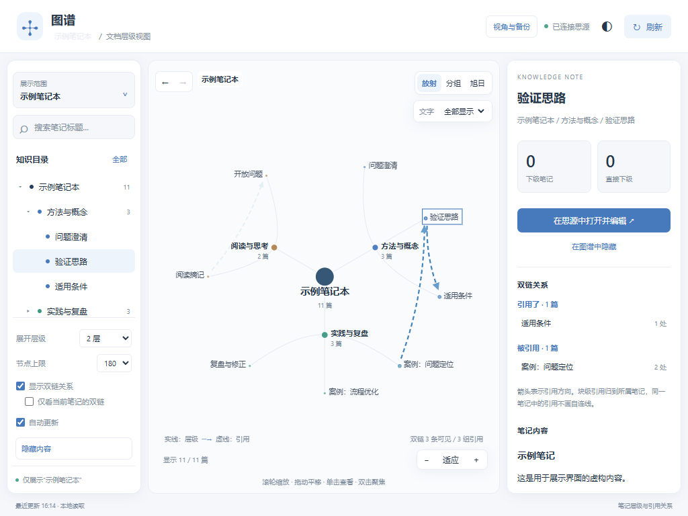

# 图谱

看见笔记的层级与联系。

把思源中选定笔记本的真实文档层级展示为可交互地图，并叠加已有的原生块引用关系。支持放射、分组、旭日三种布局。



上图使用虚构的示例笔记，不包含真实用户资料。插件当前界面为简体中文。

## 开始使用

1. 在思源集市启用“图谱”。
2. 点击右上角图谱按钮，或使用 `Alt + Shift + K` 打开；命令面板也提供“打开图谱”。
3. 首次打开不会自动选择笔记本。点击“展示范围”，勾选要展示的可用笔记本并应用。

明确清空选择后图谱会保持为空。关闭、锁定或不存在的笔记本不会被自动替换成其他笔记本。已有旧版个人安装的本机设置或工作空间备份可继续使用。

## 功能

- 三种布局：文档父子关系来自思源目录。单击查看详情，双击聚焦主题；支持拖动、缩放、搜索和展开层级/节点上限。
- 文字：三种布局共用“全部显示/自动显示”。全部模式为每个已展示节点加上名称，自动模式减少密集文字，放大后显示更多。长标题可能省略，悬停或详情中可查看完整名称。
- 双链：虚线箭头显示思源原生块引用。引用段落归到其所属笔记，正反方向分别保留；右侧列出“引用了/被引用”和次数。
- 隐藏：可以隐藏任意笔记或整个分支，并随时恢复。隐藏内容从图谱、目录、搜索、统计和双链中同时排除，原文不变。
- 常用视角：保存展示范围、全套隐藏规则、布局、文字模式、主题、双链选项、自动更新、层级、节点上限、搜索和当前视野。支持同名更新与删除。
- 续看与历史：下次打开继续上次主题、选中项和缩放平移。左上角箭头可后退/前进，历史不会撤销当前隐藏规则。
- 设置备份：顶部“视角与备份”支持导出 JSON、校验后恢复；在思源宿主内还会通过插件数据接口保存设置。

## 数据与隐私

插件不调用 AI 或外部分析服务，不写入、移动或删除笔记正文，也不把笔记上传到插件作者的服务器。

笔记本列表仅读取名称与可用状态；目录和引用查询限定在用户选择的可用笔记本。正文仅在选中可见笔记后读取，打开原文前再次核对所属范围。

隐藏是一项展示筛选，所选范围的目录索引仍会保留以便恢复；它不是加密或权限隔离。想排除整个笔记本，可以直接取消“展示范围”中的勾选。

本机存储保存笔记本选择、隐藏 ID、显示偏好、视角与上次位置。思源宿主通过官方插件 `saveData/loadData` 接口读写固定文件 `data/storage/petal/personal-knowledge-atlas/atlas-settings.json`。多个设备共享工作空间时，以最后保存的设置为准。已有本机设置不会被自动覆盖；本机图谱设置完全为空时，才在读取目录前尝试恢复工作空间备份。

导出的设置备份不包含笔记正文、附件或 API token。原笔记仍需使用思源自己的备份。独立打开的网页不具备宿主自动备份接口，但可使用文件导出。

本插件不在思源网页发布服务中启用，不提供公开笔记展示或访客数据快照。

## 限制与兼容性

- 最低版本声明为思源 3.8.9。本次在 Windows 桌面端与桌面浏览器中验证，未进行 macOS/Linux 实机验证；未声明移动端支持。窄窗口排版不等于已支持思源移动端。
- 关系来自原生块引用。普通网页链接、`siyuan://blocks/...` 超链接和 AI 推测的语义关系不计入双链。
- 图谱是笔记层级与引用的可视化入口，不会自动把资料整理成知识体系。
- 每个画面最多显示 800 个节点，最多绘制 600 条引用；读取约一万组引用后会提示缩小范围。标题搜索可以定位未展开的笔记。
- 全部文字模式在高密度下仍可能拥挤，可以放大、聚焦或改用自动模式。
- 最多保存 40 个视角，窗口导航历史最多 60 步，设置文件上限为 4 MB。

## 离线安装

将 Release 中的 `package.zip` 解压到思源工作空间的 `data/plugins/personal-knowledge-atlas/`，确认 `plugin.json` 和 `index.js` 直接位于该目录，再在思源设置中启用插件。停用插件不影响原始笔记。

## 开发与打包

本项目使用原生 JavaScript/SVG，无运行时第三方依赖。打包需要 Python 3；单元测试使用 Node.js。

```sh
node --test tests/public.test.cjs
python build.py
```

命令会在仓库根目录生成 `package.zip`。该文件是安装包；源代码压缩包不能直接替代它。

发布时，确保 `plugin.json` 中作者与仓库 URL 对应实际维护者，仓库名与插件 `name` 一致。本插件仓库为 [370958248/personal-knowledge-atlas](https://github.com/370958248/personal-knowledge-atlas)。

## License

MIT，见 [LICENSE](LICENSE)。
